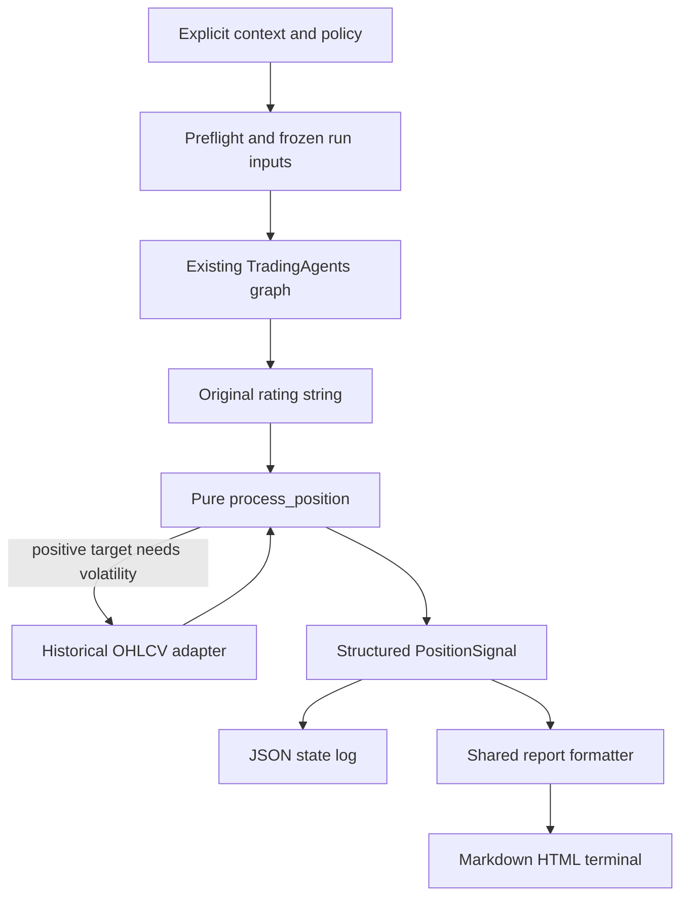

# R3 architecture blueprint

This is a retrospective consolidation dated 2026-11-17. Pre-code policy/test approval exists separately; this file is not backdated approval evidence.

## Scope and authority

The existing analyst/debate/trader/risk/portfolio graph proposes an unchanged five-tier rating. Deterministic Python has the final authority over the numeric position. No broker, share count, portfolio valuation, additional model or new website is introduced. R4 settlement and R5 tracking remain the existing implementations.

`position.py` owns mapping/limits/statuses, `position_inputs.py` owns explicit context/history/snapshot validation, `position_processing.py` owns run preparation and the shared completion hook, and `position_reporting.py` formats recorded values. `record_decision` computes R3 before logging; both API and CLI use it. Presentation never refetches/recomputes.

## Boundaries and observability

Malformed explicit config is rejected before model work; runtime historical data failures retain the existing AI analysis and produce needs_data. BudgetExceeded propagates. Only an ok target is executable guidance; no orders are executed. Prepared context/policy are detached from mutable config and participate in checkpoint signatures; a later run rereads changed input files. status/reason/cap_override/policy/input_digest and market metadata identify the actual computation.

Changes to policy/safety semantics require a new explicit decision and targeted tests; normal source fixes remain through the real OpenCode workflow. Human approvals must be attributed to actual user decisions, not to Codex-generated review prompts.
